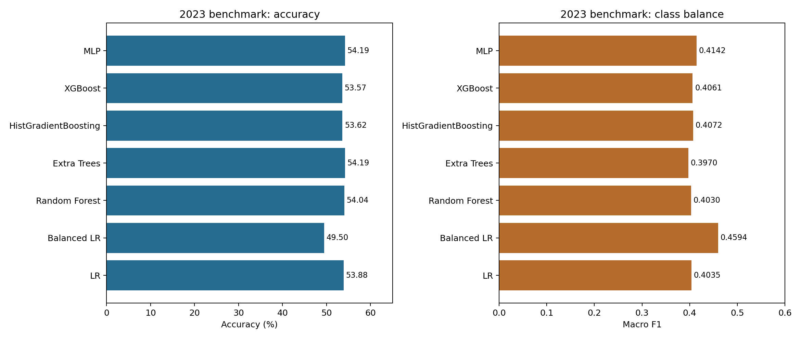
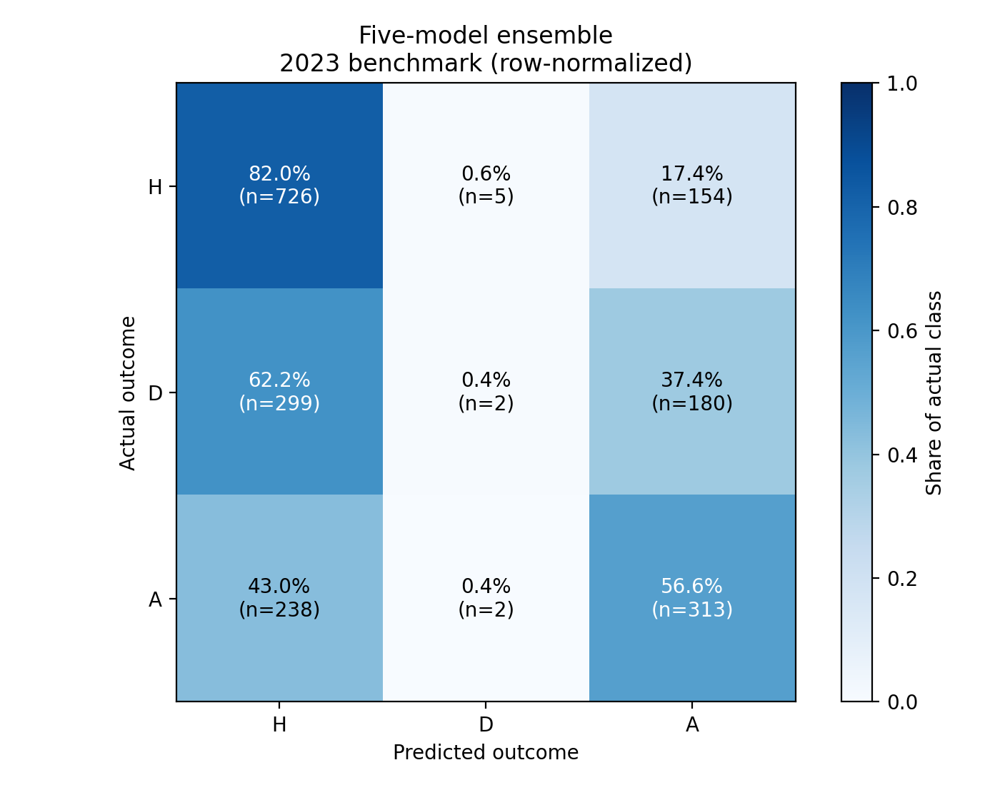
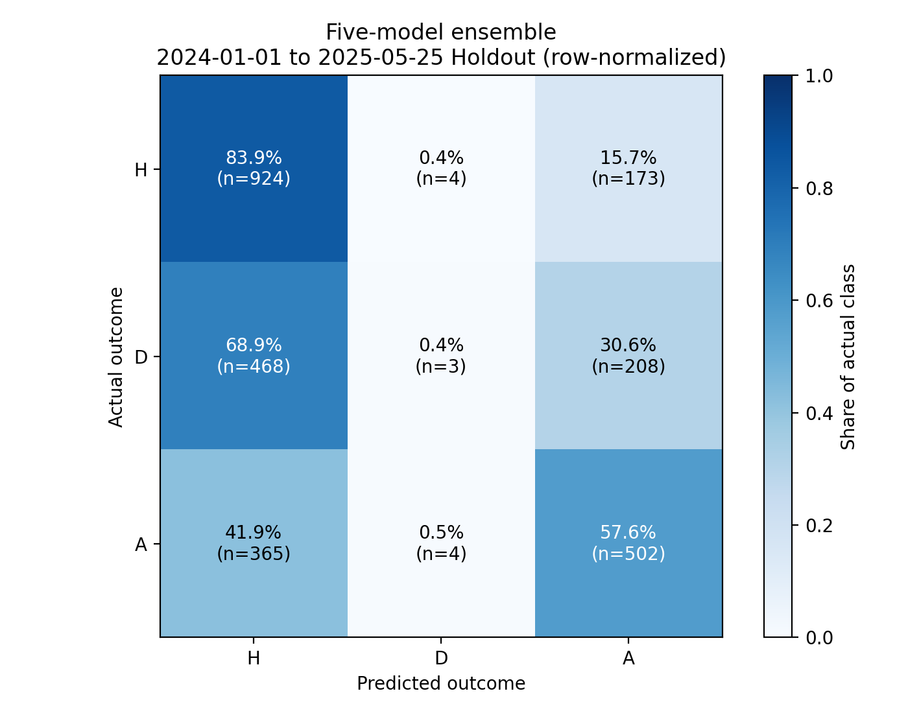
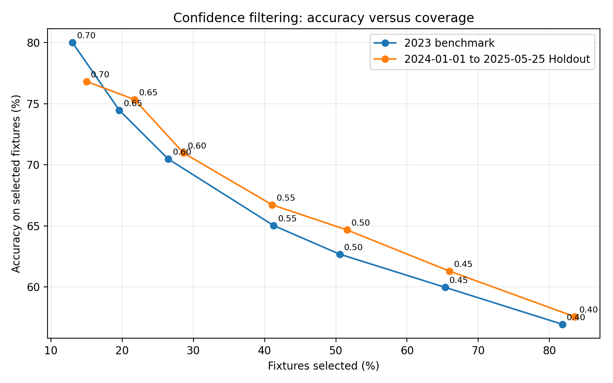
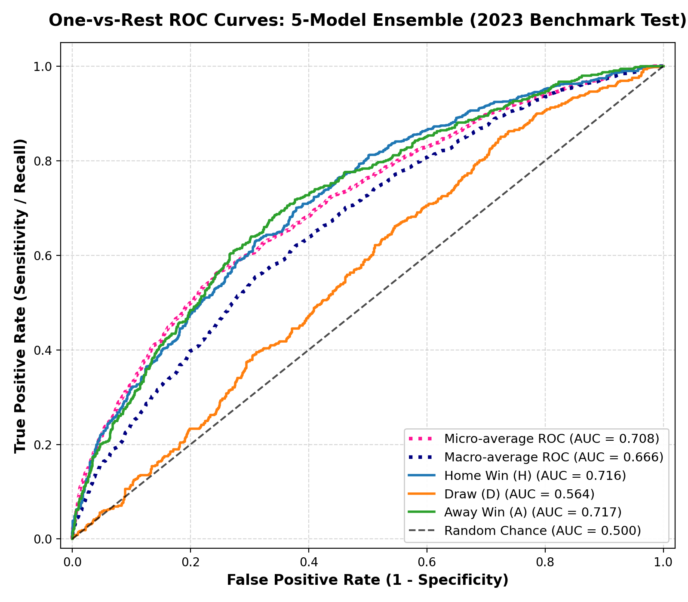
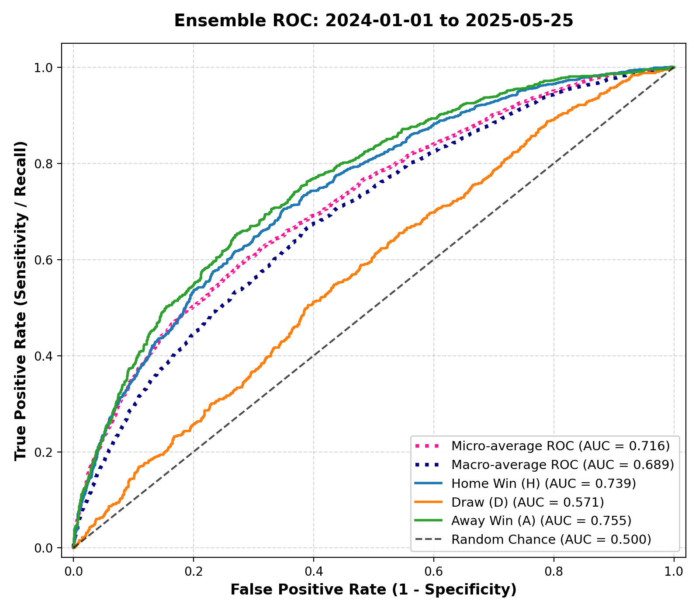
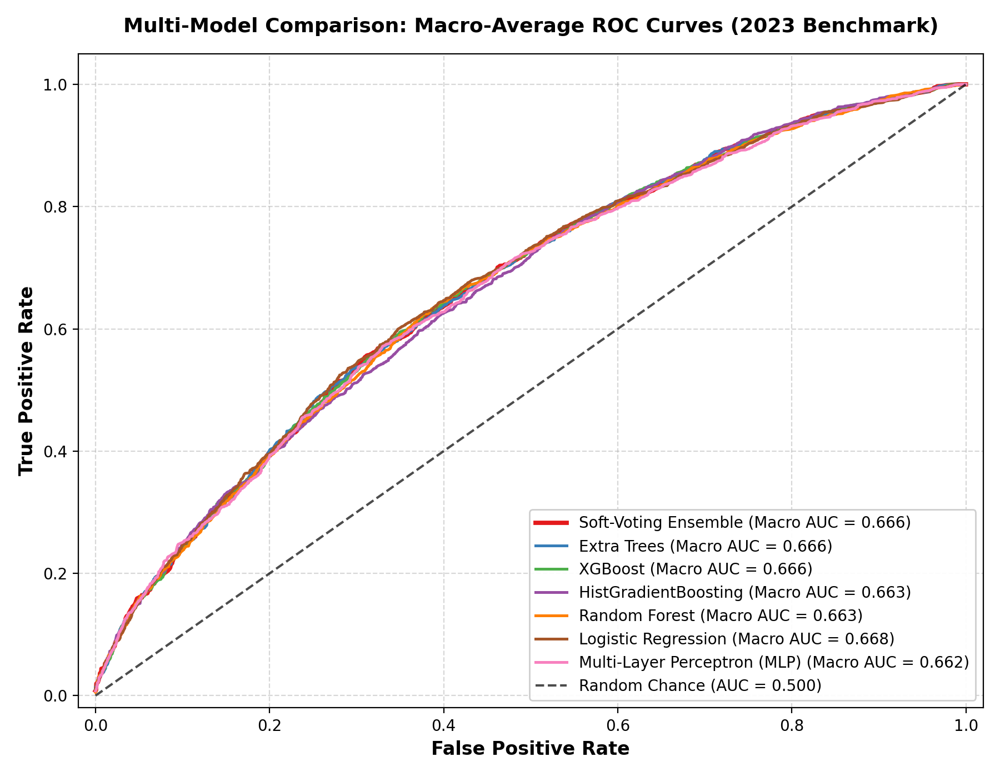
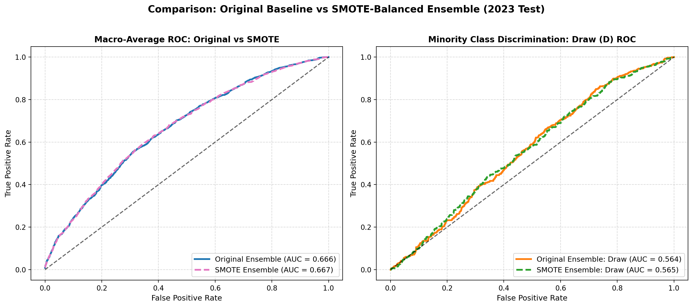
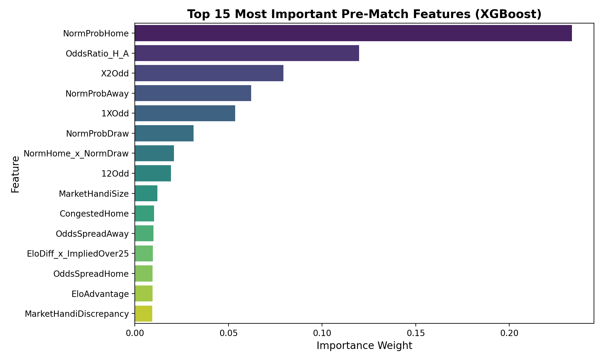
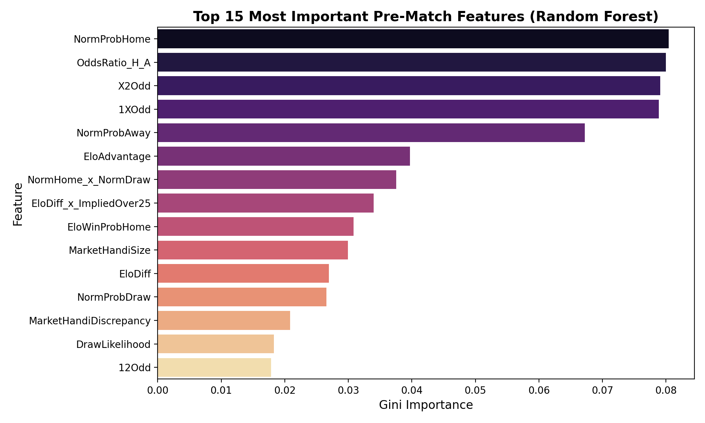

# Football Match Outcome Prediction — Dataset 1

Verified results generated on **2026-10-30** from the recorded input snapshot.

## Data and evaluation scope

The verified input contains **230,557 raw rows** and **43,708 selected five-league matches**. The selected dates are **2000-07-28 to 2025-05-25**.

| Partition | Matches | First date | Last date |
| --- | --- | --- | --- |
| Training | 39138 | 2000-07-28 | 2022-12-31 |
| Benchmark test | 1919 | 2023-01-01 | 2023-12-31 |
| Temporal holdout | 2651 | 2024-01-01 | 2025-05-25 |

| Division | Selected historical matches |
| --- | --- |
| D1 | 7522 |
| E0 | 9410 |
| F1 | 8756 |
| I1 | 9012 |
| SP1 | 9008 |

The input is not bundled in Git. Place your own copy at `data/raw/Matches.csv`. The exact snapshot used here has SHA-256:

`eac9d0096993c8a5705f724e0ddc5513f71aca29058106182bc9a2c6340bcc0e`

The available holdout has **2,651 matches**, ending **2025-05-25**. The earlier claim of 4,502 holdout matches extending into 2026 is superseded; this run does not evaluate 2026 fixtures.

## Method

The target encoding is H=0, D=1, A=2. Training uses matches through 2022; 2023 is the benchmark; all later available matches form the holdout. Model parameters are fixed by `src/models.py`; the random seed is 42. Rolling goals, shots, corners, cards, venue statistics, rest, and H2H use past fixtures. Supplied Elo/form and closing odds are assumed to be available before kickoff; their upstream provenance is not independently established by this code.

The E9 feature set contains 56 features, including market probabilities, Elo gaps, rolling form and goals, rest/congestion, and H2H. The weighted ensemble combines **Extra Trees 0.35, XGBoost 0.20, HistGradientBoosting 0.20, Random Forest 0.15, and ordinary logistic regression 0.10**. Balanced LR is a separate benchmark and cannot overwrite the ordinary LR fit.

SMOTE resamples only imputed training data. This preserves the existing experimental method: distance-based SMOTE is applied before scaling, which can make large-scale features dominate neighbor selection; a scale-aware variant requires a separately validated experiment. Test and holdout data are never resampled. The draw multiplier changes the decision rule, not the stored raw probability estimates, and is not evidence of probability calibration.

Feature sets, draw multipliers and confidence thresholds are reported descriptively. Their comparison on the benchmark is not a separate validation procedure, and repeated inspection of the holdout means it should not be treated as a pristine final test. Empirical 54% results do not establish a mathematical accuracy ceiling or prove that higher results imply leakage.

## Feature progression

| Experiment | Model | Features | Accuracy | Macro F1 | Draw recall |
| --- | --- | --- | --- | --- | --- |
| E0 | logistic_regression | 5 | 46.12% | 0.2104 | 0.00% |
| E1 | logistic_regression | 11 | 53.10% | 0.3842 | 0.00% |
| E2 | logistic_regression | 20 | 53.15% | 0.3845 | 0.00% |
| E3 | xgboost | 35 | 53.36% | 0.3877 | 0.42% |
| E4 | xgboost | 44 | 53.41% | 0.3885 | 0.21% |
| E5 | xgboost | 63 | 53.52% | 0.3924 | 0.21% |
| E6 | xgboost | 71 | 54.40% | 0.4123 | 1.87% |
| E7 | xgboost | 28 | 53.52% | 0.4025 | 1.04% |
| E8 | xgboost | 39 | 53.62% | 0.4080 | 2.08% |
| E9 | extra_trees | 56 | 54.19% | 0.3970 | 0.00% |

These are measured comparisons for the recorded data snapshot. Adding features does not guarantee an accuracy increase; results also depend on the chosen classifier.

## Model benchmark (2023, 1,919 matches)

| Model | Accuracy | Macro F1 | Home recall | Draw recall | Away recall |
| --- | --- | --- | --- | --- | --- |
| Logistic Regression | 53.88% | 0.4035 | 80.00% | 0.83% | 58.23% |
| Balanced Logistic Regression | 49.50% | 0.4594 | 54.12% | 22.66% | 65.46% |
| Random Forest | 54.04% | 0.4030 | 81.24% | 0.83% | 56.78% |
| Extra Trees | 54.19% | 0.3970 | 83.16% | 0.00% | 54.97% |
| HistGradientBoosting | 53.62% | 0.4072 | 79.89% | 1.87% | 56.60% |
| XGBoost | 53.57% | 0.4061 | 80.11% | 1.66% | 56.24% |
| Multi-Layer Perceptron (MLP) | 54.19% | 0.4142 | 81.02% | 2.70% | 56.06% |



Accuracy measures the share of correct outcomes. Macro F1 gives H, D, and A equal weight; low draw recall can therefore produce a low Macro F1 despite reasonable overall accuracy.

## Ensemble and temporal holdout

| Evaluation | Matches | Accuracy | Macro F1 | Draw recall |
| --- | --- | --- | --- | --- |
| 2023 ensemble | 1919 | 54.25% | 0.4019 | 0.42% |
| 2023 ensemble, draw multiplier 1.20 | 1919 | 52.89% | 0.4229 | 6.24% |
| 2024-01-01 to 2025-05-25 Holdout | 2651 | 53.90% | 0.4092 | 0.44% |
| 2023 SMOTE ensemble | 1919 | 52.37% | 0.4494 | 11.85% |
| Holdout SMOTE ensemble | 2651 | 53.53% | 0.4634 | 11.63% |

The baseline ensemble obtains **54.25% accuracy and 0.4019 Macro F1** on all 2023 fixtures. It obtains **53.90% accuracy** on the available holdout. These measurements describe this snapshot and do not prove absence of temporal degradation or probability calibration.



Rows are actual classes and columns are predicted classes. The diagonal gives per-class recall; the draw row shows the baseline's difficulty predicting draws.



The holdout uses the same trained ensemble, with histories updated sequentially from earlier completed matches. Its dates and sample count differ from the former 2026 claim.

## Draw decision multiplier (XGBoost)

| XGBoost draw multiplier | Accuracy | Macro F1 | Draw recall |
| --- | --- | --- | --- |
| 1.00 | 53.57% | 0.4061 | 1.66% |
| 1.15 | 52.84% | 0.4204 | 5.20% |
| 1.25 | 51.64% | 0.4325 | 10.40% |
| 1.35 | 51.17% | 0.4559 | 21.21% |
| 1.50 | 49.30% | 0.4645 | 33.89% |

Multiplying the draw score can raise draw recall and Macro F1 while lowering accuracy. These are sensitivity results on the benchmark; a deployment multiplier must be selected on separate validation data.

## SMOTE comparison

| Model | Baseline accuracy | SMOTE accuracy | Baseline Macro F1 | SMOTE Macro F1 | Baseline draw recall | SMOTE draw recall |
| --- | --- | --- | --- | --- | --- | --- |
| Logistic Regression | 53.88% | 49.40% | 0.4035 | 0.4532 | 0.83% | 19.96% |
| Random Forest | 54.04% | 51.64% | 0.4030 | 0.4543 | 0.83% | 15.18% |
| Extra Trees | 54.19% | 50.55% | 0.3970 | 0.4698 | 0.00% | 24.32% |
| HistGradientBoosting | 53.62% | 53.00% | 0.4072 | 0.4298 | 1.87% | 6.86% |
| XGBoost | 53.57% | 53.20% | 0.4061 | 0.4161 | 1.66% | 3.12% |
| Multi-Layer Perceptron (MLP) | 54.19% | 49.61% | 0.4142 | 0.4538 | 2.70% | 23.08% |
| Five-model ensemble (2023) | 54.25% | 52.37% | 0.4019 | 0.4494 | 0.42% | 11.85% |
| Five-model ensemble (holdout) | 53.90% | 53.53% | 0.4092 | 0.4634 | 0.44% | 11.63% |

The same five-model membership and weights are used for the baseline and SMOTE ensembles. SMOTE changes training balance; it does not improve every metric for every classifier.

## Confidence filtering

Confidence is the maximum predicted class probability. A threshold accepts only fixtures meeting that score; the displayed accuracy applies only to that subset.

### 2023 benchmark

| Minimum confidence | Selected | Correct | Coverage | Selected accuracy |
| --- | --- | --- | --- | --- |
| 0.40 | 1570 | 894 | 81.81% | 56.94% |
| 0.45 | 1254 | 752 | 65.35% | 59.97% |
| 0.50 | 970 | 608 | 50.55% | 62.68% |
| 0.55 | 792 | 515 | 41.27% | 65.03% |
| 0.60 | 508 | 358 | 26.47% | 70.47% |
| 0.65 | 376 | 280 | 19.59% | 74.47% |
| 0.70 | 250 | 200 | 13.03% | 80.00% |

### 2024-01-01 to 2025-05-25 Holdout

| Minimum confidence | Selected | Correct | Coverage | Selected accuracy |
| --- | --- | --- | --- | --- |
| 0.40 | 2215 | 1275 | 83.55% | 57.56% |
| 0.45 | 1749 | 1072 | 65.98% | 61.29% |
| 0.50 | 1367 | 884 | 51.57% | 64.67% |
| 0.55 | 1088 | 726 | 41.04% | 66.73% |
| 0.60 | 758 | 538 | 28.59% | 70.98% |
| 0.65 | 576 | 434 | 21.73% | 75.35% |
| 0.70 | 397 | 305 | 14.98% | 76.83% |




Point labels are confidence thresholds. Higher selected accuracy usually comes with fewer accepted matches. These empirical confidence scores have not been demonstrated to be calibrated probabilities.

## Double chance

| Evaluation | Correct / total | Double-chance accuracy |
| --- | --- | --- |
| 2023 Benchmark Test | 1,534 / 1,919 | 79.94% |
| 2024-01-01 to 2025-05-25 Holdout | 2,127 / 2,651 | 80.23% |

Double chance accepts two of the three outcomes (1X, X2, or 12). It is a different, easier target than a single H/D/A prediction and must not be presented as 3-way accuracy.

## ROC-AUC

| Model | Evaluation | AUC H | AUC D | AUC A | Macro curve AUC | Micro AUC |
| --- | --- | --- | --- | --- | --- | --- |
| Extra Trees | 2023 Benchmark Test | 0.7165 | 0.5635 | 0.7169 | 0.6660 | 0.7087 |
| XGBoost | 2023 Benchmark Test | 0.7147 | 0.5674 | 0.7157 | 0.6663 | 0.7070 |
| HistGradientBoosting | 2023 Benchmark Test | 0.7123 | 0.5596 | 0.7151 | 0.6627 | 0.7054 |
| Random Forest | 2023 Benchmark Test | 0.7148 | 0.5598 | 0.7144 | 0.6634 | 0.7066 |
| Logistic Regression | 2023 Benchmark Test | 0.7160 | 0.5696 | 0.7166 | 0.6678 | 0.7084 |
| Multi-Layer Perceptron (MLP) | 2023 Benchmark Test | 0.7124 | 0.5611 | 0.7121 | 0.6623 | 0.7034 |
| Soft-Voting Ensemble (5 Models) | 2023 Benchmark Test | 0.7158 | 0.5640 | 0.7169 | 0.6660 | 0.7084 |
| Soft-Voting Ensemble (5 Models) | 2024-01-01 to 2025-05-25 Holdout | 0.7392 | 0.5715 | 0.7554 | 0.6890 | 0.7165 |
| SMOTE Soft-Voting Ensemble | 2023 Benchmark Test | 0.7172 | 0.5646 | 0.7174 | 0.6668 | 0.6961 |

ROC measures ranking over possible thresholds. Draw AUC near 0.5 indicates weak discrimination. Macro curve AUC is the area under the interpolated mean ROC curve; micro AUC pools the one-vs-rest decisions. AUC does not establish probability calibration or a universal accuracy ceiling.









All ROC curves use the saved probabilities from the run that produced the benchmark table.

## Feature importance

| Rank | Feature | XGBoost importance | RF impurity importance |
| --- | --- | --- | --- |
| 1 | NormProbHome | 0.2335 | 0.0805 |
| 2 | OddsRatio_H_A | 0.1197 | 0.0800 |
| 3 | X2Odd | 0.0793 | 0.0791 |
| 4 | NormProbAway | 0.0621 | 0.0672 |
| 5 | 1XOdd | 0.0536 | 0.0789 |
| 6 | NormProbDraw | 0.0314 | 0.0266 |
| 7 | NormHome_x_NormDraw | 0.0210 | 0.0376 |
| 8 | 12Odd | 0.0192 | 0.0179 |
| 9 | MarketHandiSize | 0.0121 | 0.0300 |
| 10 | CongestedHome | 0.0103 | 0.0006 |
| 11 | OddsSpreadAway | 0.0100 | 0.0128 |
| 12 | EloDiff_x_ImpliedOver25 | 0.0097 | 0.0340 |
| 13 | OddsSpreadHome | 0.0095 | 0.0153 |
| 14 | EloAdvantage | 0.0095 | 0.0397 |
| 15 | MarketHandiDiscrepancy | 0.0093 | 0.0208 |





Importances describe these fitted models, not causal effects. Correlated market features can share importance; RF values in the table are aligned to the XGBoost-ranked rows, while its figure uses RF's own ranking.

## Error slices (same five-model ensemble)

| Division | Matches | Accuracy |
| --- | --- | --- |
| D1 | 314 | 53.82% |
| E0 | 412 | 57.77% |
| F1 | 373 | 52.28% |
| I1 | 410 | 53.41% |
| SP1 | 410 | 53.66% |

| Empirical |Elo difference| interval | Matches | Accuracy |
| --- | --- | --- |
| 0.04 to 48.82 | 480 | 46.04% |
| 49.16 to 105.28 | 480 | 52.71% |
| 105.31 to 175 | 479 | 54.91% |
| 175.12 to 467.21 | 480 | 63.33% |

The Elo intervals above are empirical quartiles calculated from the 2023 fixtures. They replace the former incorrect fixed-range labels. Small slice differences require uncertainty analysis before strong conclusions.

## Reproduce or inspect

Use Python 3.12 and a clean environment:

```bash
python -m venv .venv
# Windows PowerShell:
.\.venv\Scripts\Activate.ps1
# macOS/Linux: source .venv/bin/activate
python -m pip install -r requirements-reproducible.txt
# Place the verified input at data/raw/Matches.csv, then run:
python src/run_pipeline.py
python -m unittest discover -s tests -v
```

One command trains all baseline/progression/SMOTE models, exports predictions, and regenerates all tables, figures, README, research results, and the notebook. The legacy SMOTE entry point now invokes the same complete run. Diagnostic scripts only read saved outputs, avoiding a second model definition. Small numerical changes across operating systems or numerical libraries remain possible; compare the manifest and input hash before attributing differences to models.

Key outputs:

- `results/experiment_results.csv`: full precision metrics with sample counts and dates.
- `results/predictions.npz`: actual labels, decisions, and H/D/A probabilities for every experiment; inspect using `numpy.load(..., allow_pickle=False)`.
- `results/error_analysis_test2023.csv` and `results/predictions_holdout.csv`: per-fixture baseline ensemble predictions, probabilities, and actual classes.
- `results/run_manifest.json`: input SHA-256, package versions, split counts/dates, features, ensemble weights, and source hashes.
- `results/artifact_hashes.json`: hashes of the generated result files.
- `notebooks/Dataset1_Predictor.ipynb`: exploration of these exact saved outputs; no independent fitting.
- `RESEARCH_PAPER.md`: regenerated technical report using the same result tables.

Generated numeric documentation comes from `src/refresh_results.py`; edit its template instead of hand-copying results. The raw and processed input datasets remain excluded by `.gitignore`.

## What was corrected

- README tables and figures now derive from one recorded run, replacing mixed historical summaries.
- Ordinary and balanced logistic regression have separate storage keys and confusion matrices.
- Error analysis, ROC curves, and benchmarks use the same five-model ensemble and saved probabilities.
- Holdout dates/counts reflect the available data instead of an unsupported 2026 extension.
- Old figures from superseded E8/three-model runs are removed rather than mixed with regenerated figures.
- Unsupported claims of a universal 54–56% ceiling, guaranteed zero degradation, and proven probability calibration are removed.

The former research write-up contained results from multiple runs and unsupported literature comparisons. Its empirical report is regenerated here; the previous text remains available in Git history. This correction does not certify the accuracy of the earlier external literature claims or update separate PDF/PPT files outside this repository.
